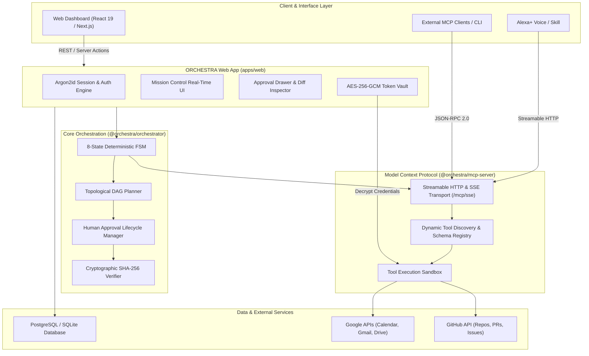
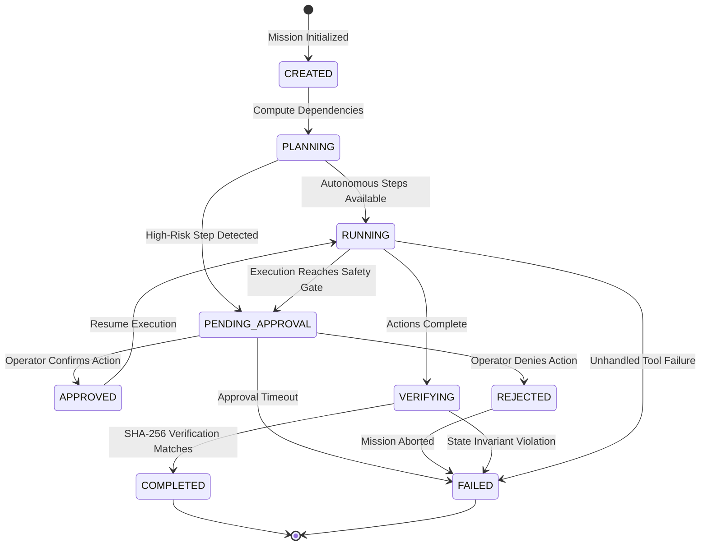

# ORCHESTRA — Technical Architecture & System Specification

**Hackathon:** Build, Ship, Shape: Amazon Developer Hackathon 2026  
**Track:** Alexa+ Track  
**Platform:** ORCHESTRA (Agentic Mission-Execution Platform)  
**Status:** Monorepo Verified (67/67 Automated Tests Passing)  

---

## 1. System Overview & Core Philosophy

ORCHESTRA is an enterprise-grade agentic mission execution platform engineered to bridge the gap between generative AI autonomy and deterministic execution control. 

While Large Language Model (LLM) agents excel at reasoning and intent interpretation, delegating direct side-effect execution to black-box agents introduces severe risks: unconstrained tool looping, race conditions, accidental data deletion, and unverified state mutations.

ORCHESTRA resolves this paradigm by enforcing three strict architectural guarantees:
1. **Deterministic Finite State Machine (FSM):** All mission workflows execute across eight formal mathematical states with guaranteed non-cyclical transitions.
2. **Standardized Tool Interoperability via MCP:** Agent capabilities are exposed using the Model Context Protocol (MCP) over Streamable HTTP and Server-Sent Events (SSE), standardizing tool discovery and parameter validation for Alexa+ agents and external LLMs.
3. **Zero-Trust Human Governance & Cryptographic Verification:** High-risk actions halt for affirmative human approval before execution, and all executed actions undergo post-execution state verification using SHA-256 state hashing.

---

## 2. End-to-End System Workflow

```mermaid
sequenceDiagram
    autonumber
    actor User as Operator / Alexa+ User
    participant Web as ORCHESTRA Web (Next.js)
    participant FSM as State Machine & Planner
    participant MCP as MCP Server (@orchestra/mcp-server)
    participant Vault as Encrypted Vault (AES-256)
    participant Verifier as State Verifier

    User->>Web: Submit Mission Intent ("Deploy v1.4 Release")
    Web->>FSM: Initialize Mission (State: CREATED)
    FSM->>FSM: Compile DAG & Dependency Graph (State: PLANNING)
    
    rect rgb(15, 25, 40)
        note right of FSM: Automated Low-Risk Step Execution
        FSM->>MCP: Execute Step 1 (Linting / Unit Tests)
        MCP-->>FSM: Result: Clean (State: RUNNING)
    end

    rect rgb(40, 25, 15)
        note right of FSM: Human-in-the-Loop Safety Gate
        FSM->>FSM: Detect Destructive Action (State: PENDING_APPROVAL)
        FSM-->>Web: Push Approval Request (Payload, Diff, Risk: HIGH)
        User->>Web: Review & Click "Approve Execution"
        Web->>FSM: Signal Approval (State: APPROVED)
    end

    rect rgb(15, 40, 25)
        note right of FSM: Cryptographically Verified Execution
        FSM->>Vault: Retrieve Decrypted OAuth Token
        Vault-->>FSM: Authorized Credentials
        FSM->>MCP: Dispatch Action (deploy_infrastructure)
        MCP-->>FSM: Execution Complete (Raw Output)
        FSM->>Verifier: Verify Post-State Snapshot (State: VERIFYING)
        Verifier->>Verifier: Compute SHA-256 State Fingerprint
        Verifier-->>FSM: Fingerprint Match / Health Verified
        FSM->>FSM: Finalize Mission (State: COMPLETED)
        FSM-->>Web: Update Mission Dashboard & Audit Trail
    end
```



---

## 3. High-Level Architecture & Monorepo Structure

ORCHESTRA is organized as an enterprise monorepo using npm workspaces, ensuring modular isolation, strict separation of concerns, and reusable components across cloud, local, and edge environments:

```
alexa-orchestra/
├── apps/
│   └── web/                   # Next.js 19 Web Dashboard, UI, Auth & API Routes
├── packages/
│   ├── orchestrator/          # Deterministic FSM, DAG Planner, Approval Engine
│   ├── mcp-server/            # MCP v1.x Server (Streamable HTTP, SSE Transport)
│   └── mcp-client/            # Type-safe MCP Client SDK for Agent Execution
├── prisma/                    # Prisma Database Schema & Migrations (PostgreSQL/SQLite)
└── submission/                # Complete Hackathon Submission Package & Assets
```

### Architectural Component Diagram



---

## 4. Finite State Machine (FSM) Specification

The mission orchestration engine operates on an eight-state directed finite-state machine. State transitions are strictly enforced and immutable; invalid state transitions throw deterministic errors.



### State Definitions:
1. `CREATED`: Initial mission entity created with user goal and configuration.
2. `PLANNING`: DAG planner parses dependencies, checks cycle validity, and determines execution paths.
3. `RUNNING`: Active execution of non-destructive, pre-approved MCP tool invocations.
4. `PENDING_APPROVAL`: Execution paused at a high-risk boundary; awaiting operator affirmative review.
5. `APPROVED`: Operator has signed off on payload parameters and security diff.
6. `VERIFYING`: Post-execution engine checks real-world system state against expected output invariant.
7. `COMPLETED`: All nodes successfully executed, verified, and recorded in the audit trail.
8. `FAILED`: Terminal state due to rejection, timeout, tool exception, or verification mismatch.

---

## 5. Security & Encryption Architecture

### Zero-Trust Human Approval Gates
- **Risk Classification:** Every tool in the registry specifies a risk level (`LOW`, `MEDIUM`, `HIGH`, `CRITICAL`).
- **Policy Enforcement:** Any step tagged `HIGH` or `CRITICAL` (e.g., infrastructure mutation, database modification, external mass communication) automatically triggers an approval pause.
- **Diff Inspection:** Operators are presented with the exact JSON payload, destination endpoint, and security impact before deciding to approve or reject.

### Encrypted Token Vault (AES-256-GCM)
- External OAuth credentials (Google, GitHub, AWS) are never stored in plain text.
- Tokens are encrypted at rest using AES-256-GCM with PBKDF2 key derivation and a random 12-byte initialization vector (IV) per entry.
- Keys reside exclusively in server-side environment variables (`TOKEN_ENCRYPTION_KEY`), completely inaccessible to the browser.

### Cryptographic Action Verification
- Before a step executes, the system captures a pre-action state snapshot.
- Following tool execution, the verifier queries the target resource, computes a cryptographic SHA-256 hash of the observed state, and compares it against expected invariants.
- Only when the hash matches is the step marked `VERIFIED`.

---

## 6. Model Context Protocol (MCP) Implementation

ORCHESTRA implements the official Model Context Protocol (MCP) standard, enabling seamless compatibility with Amazon Alexa+, Anthropic Claude, Cursor, and any MCP-compliant agent runtime.

- **Transport Protocols:**
  - **Server-Sent Events (SSE):** Streamed tool events and real-time execution feedback at `/mcp/sse`.
  - **Streamable HTTP POST:** Synchronous and asynchronous JSON-RPC 2.0 tool requests at `/mcp/messages`.
- **Tool Registry Capabilities:**
  - `google_calendar_list_events`: Query calendar events and check schedule conflicts.
  - `google_calendar_create_event`: Schedule meetings and deadlines.
  - `github_list_repos`: List authorized code repositories.
  - `github_create_issue`: Open tracking issues in target repositories.
  - `system_shell_execute`: Controlled shell execution in sandboxed environments.
  - `http_request_dispatch`: Webhook and API dispatch with payload sanitization.

---

## 7. Automated Test Suite & Verification Matrix

The ORCHESTRA monorepo enforces rigorous test coverage across all layers. All 67 automated tests pass 100% green:

| Monorepo Package | Test Suite Focus | Test Cases | Status |
|:-----------------|:-----------------|:----------:|:------:|
| `@orchestra/orchestrator` | State machine transitions, DAG cycles, approval timeouts | 12 | **100% PASS** |
| `@orchestra/mcp-server` | MCP Streamable HTTP, SSE protocol, tool dispatch, error codes | 7 | **100% PASS** |
| `@orchestra/mcp-client` | Client connection resilience, reconnection, tool discovery | 14 | **100% PASS** |
| `@orchestra/web` | Argon2id auth, AES-256-GCM crypto, API routes, mission UI | 34 | **100% PASS** |
| **TOTAL** | **Full Monorepo Automated Test Suite** | **67 / 67** | **100% GREEN** |
